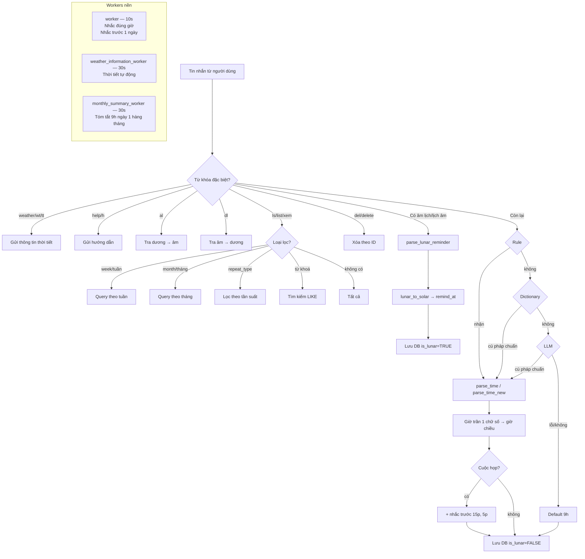

# Telegram Bot Reminder

Bot nhắc lịch cá nhân qua Telegram, hỗ trợ **lịch dương**, **lịch âm**, **thời tiết**, và **tóm tắt lịch định kỳ**.

Người dùng có thể gõ theo cú pháp hoặc chat tự nhiên ("Mai e email cho đối tác nhé", "5h cả nhóm lên phòng làm tiếp"), kể cả tin forward. Tin nhắn đi qua 4 tầng **Rule → Dictionary → LLM → Default**; tầng Dictionary (từ điển `dictionary.json`) xử lý phần lớn câu tự nhiên nên rất ít khi phải gọi LLM. Tin xác nhận luôn ghi tầng đã nhận diện: `🏷 Nhận diện bởi: Rule / Dictionary / LLM / Default`.

Mỗi lịch còn được phân **loại việc** (intent: họp, mời ăn, hạn chót, thanh toán...) bằng từ điển `intents.json`, và bot nhắc thêm theo loại: họp nhắc trước 15/5 phút, mời ăn trước 45/30 phút, hạn chót trước 1 ngày...

Tài liệu chi tiết: [docs/dictionary.md](docs/dictionary.md) (từ điển thời gian), [docs/intents.md](docs/intents.md) (intent).

---

## Mục lục

- [Telegram Bot Reminder](#telegram-bot-reminder)
  - [Mục lục](#mục-lục)
  - [Kiến trúc tổng thể](#kiến-trúc-tổng-thể)
  - [Cài đặt \& Chạy](#cài-đặt--chạy)
  - [Biến môi trường](#biến-môi-trường)
  - [Cơ sở dữ liệu](#cơ-sở-dữ-liệu)
  - [Cú pháp lệnh](#cú-pháp-lệnh)
    - [Thêm reminder](#thêm-reminder)
    - [Xem danh sách](#xem-danh-sách)
    - [Xóa reminder](#xóa-reminder)
    - [Tra cứu lịch âm/dương](#tra-cứu-lịch-âmdương)
    - [Thời tiết](#thời-tiết)
  - [Quy tắc thời gian](#quy-tắc-thời-gian)
  - [Logic xử lý chính](#logic-xử-lý-chính)
    - [Khởi động \& Migration](#khởi-động--migration)
    - [Nhận diện \& phân tích câu lệnh](#nhận-diện--phân-tích-câu-lệnh)
    - [Luồng Rule → Dictionary → LLM → Default](#luồng-rule--dictionary--llm--default)
    - [Intent và nhắc thêm theo loại việc](#intent-và-nhắc-thêm-theo-loại-việc)
    - [Parse thời gian dương lịch](#parse-thời-gian-dương-lịch)
    - [Parse thời gian âm lịch](#parse-thời-gian-âm-lịch)
    - [Lịch âm – thuật toán chuyển đổi](#lịch-âm--thuật-toán-chuyển-đổi)
    - [Worker nhắc nhở](#worker-nhắc-nhở)
    - [Worker thời tiết tự động](#worker-thời-tiết-tự-động)
    - [Worker tóm tắt đầu tháng](#worker-tóm-tắt-đầu-tháng)
  - [Sơ đồ luồng xử lý](#sơ-đồ-luồng-xử-lý)
  - [Kiểm thử](#kiểm-thử)
  - [Hạn chế đã biết](#hạn-chế-đã-biết)

---

## Kiến trúc tổng thể

```
main.py
 └── telegrambot.run()
      ├── init()              — load .env, kết nối DB, chạy migrate
      ├── ApplicationBuilder  — python-telegram-bot v20
      ├── Handlers
      │    ├── /start, /help
      │    ├── /list (/ls)
      │    ├── /delete (/del)
      │    └── MessageHandler  → add_reminder()  (xử lý toàn bộ text)
      │                           ├── Rule        — parse_message() ... trong telegrambot.py
      │                           ├── Dictionary  — dictionary_parser.py + dictionary.json
      │                           ├── LLM         — llm_service.py (Gemini, dự phòng OpenRouter)
      │                           └── Default     — cả câu làm nội dung, giờ mặc định
      └── Background workers (asyncio.create_task)
           ├── worker()                  — vòng lặp nhắc lịch mỗi 10 giây
           ├── weather_information_worker() — thời tiết tự động hàng ngày
           └── monthly_summary_worker()     — tóm tắt lịch 9h ngày 1 hàng tháng
```

| File | Vai trò |
|---|---|
| `telegrambot.py` | Handler, tầng Rule, ghép luồng, lưu DB, worker |
| `dictionary_parser.py` | Tầng Dictionary: đọc `dictionary.json`, bóc thời gian, dịch về cú pháp chuẩn |
| `dictionary.json` | Từ điển thời gian: cụm từ, regex, buổi, từ khoá ý định, bộ chặn, quy tắc giờ |
| `intents.json` | Danh sách intent (loại việc), từ khoá có trọng số, hành vi nhắc thêm của từng loại |
| `llm_service.py` | Gọi Gemini/OpenRouter, prompt có quy tắc giờ mặc định |
| `lunarcalendar.py` | Chuyển đổi âm ↔ dương |
| `weather.py`, `weatherAPI.py` | Thời tiết |

**Stack:**

| Thành phần | Công nghệ |
|---|---|
| Bot framework | python-telegram-bot 20.7 (async) |
| Database | MySQL 8 |
| ORM/Driver | mysql-connector-python |
| Lịch âm | lunarcalendar.py (Ho Ngoc Duc 2004) |
| Parse thời gian | dateparser + dateutil.relativedelta |
| Hiểu câu tự nhiên | Từ điển `dictionary.json` (không tốn API), sau đó Gemini Flash / OpenRouter |
| Timezone | `ZoneInfo("Asia/Ho_Chi_Minh")` |
| Triển khai | Docker Compose (2 service: `bot` + `db`) |

---

## Cài đặt & Chạy

```bash
# 1. Tạo file .env (xem mục Biến môi trường)
cp .env.example .env

# 2. Build và chạy
docker compose up -d --build

# 3. Xem log
docker compose logs -f bot
```

> **Lần đầu** Docker tự chạy `mysql-init/01-init.sql` (tạo bảng + index).  
> **Các lần sau** `migrate()` trong code kiểm tra `information_schema.columns` trước khi thêm cột. Cách này idempotent và tương thích cả các bản MySQL không hỗ trợ `ADD COLUMN IF NOT EXISTS`.

### Triển khai production (server dùng git)

Thư mục trên server là bản clone của repo; `.env`, `backup/` và volume MySQL không nằm trong git nên không bị ảnh hưởng khi cập nhật.

```bash
# Máy dev: commit và đẩy code
git add <các file đã sửa>
git commit -m "..."
git push

# Server
cd <thư-mục-bot-trên-server>
git pull
./install.sh          # tự nhận biết lần đầu / cập nhật, build lại image và khởi động
docker compose logs -f bot
```

- `install.sh --first` / `--update` để ép chế độ.
- Image chỉ chứa các file được `COPY` trong `Dockerfile`. Khi thêm file `.py` hoặc `.json` mới mà code cần import/đọc, **phải thêm dòng `COPY` tương ứng**, nếu không bot sẽ lỗi `ModuleNotFoundError` khi chạy.
- Không sửa code trực tiếp trên server; nếu lỡ sửa, `git status` sẽ báo và `git pull` có thể bị từ chối. Bỏ thay đổi cục bộ bằng `git reset --hard HEAD` rồi `git pull` lại.
- Volume DB tên theo thư mục (`<tên-thư-mục>_db_data`), đổi tên thư mục server sẽ tạo volume mới rỗng.

---

## Biến môi trường

| Biến | Mô tả | Ví dụ |
|---|---|---|
| `BOT_TOKEN` | Token Telegram Bot | `<token từ @BotFather>` |
| `DB_HOST` | Host MySQL | `db` |
| `DB_USER` | User MySQL | `root` |
| `DB_PASSWORD` | Password MySQL | `secret` |
| `DB_NAME` | Database name | `reminder_bot` |
| `TIME_INFORMATION` | Giờ gửi thời tiết tự động (`HH:MM`) | `06:30` |
| `GOOGLE_API_KEY` | Key Google Weather (`weather.py`); cũng dùng cho Gemini nếu không có `GEMINI_API_KEY` | `<api-key>` |
| `WEATHER_CITY` / `WEATHER_LOCATION` | Thành phố mặc định thời tiết | `Ho Chi Minh` |
| `WEATHER_API_KEY` | Key cho dự báo ngày mai (`weatherAPI.py`) | `abc123...` |
| `GEMINI_API_KEY` | Key Gemini cho tầng LLM | `<api-key>` |
| `GEMINI_MODEL` | Model chính | `gemini-3.6-flash` |
| `GEMINI_FALLBACK_MODELS` | Danh sách model dự phòng, phân tách bằng dấu phẩy | `gemini-3.5-flash-lite,...` |
| `GEMINI_TIMEOUT_SECONDS` | Timeout mỗi lần gọi | `8` |
| `OPENROUTER_API_KEY` | Key OpenRouter, dự phòng khi Gemini lỗi | `<api-key>` |
| `OPENROUTER_MODELS` | Danh sách model OpenRouter | `meta-llama/llama-3.3-70b-instruct:free,...` |

> `.env.example` vẫn còn `OPENWEATHER_API_KEY` / `DEFAULT_CITY` từ bản cũ; code hiện tại đọc các biến ở bảng trên.

Không có key LLM thì bot vẫn chạy: câu không qua được Rule/Dictionary sẽ rơi xuống Default.

---

## Cơ sở dữ liệu

**Bảng `reminders`:**

```sql
CREATE TABLE reminders (
    id           INT AUTO_INCREMENT PRIMARY KEY,
    user_id      BIGINT,                    -- Telegram user ID
    message      TEXT,                      -- Nội dung nhắc
    remind_at    DATETIME,                  -- Thời điểm nhắc (dương lịch)
    repeat_type  VARCHAR(20),               -- none | daily | weekly | monthly | yearly | every_Nd | every_Nw | every_Nm | every_Ny
    is_active    BOOLEAN DEFAULT TRUE,
    is_lunar     BOOLEAN DEFAULT FALSE,     -- Có phải nhắc theo âm lịch không
    lunar_day    TINYINT UNSIGNED,          -- Ngày âm lịch gốc
    lunar_month  TINYINT UNSIGNED,          -- Tháng âm lịch gốc
    lunar_year   SMALLINT UNSIGNED,         -- Năm âm lịch gốc
    lunar_leap   BOOLEAN DEFAULT FALSE,     -- Tháng nhuận
    intent       VARCHAR(20) DEFAULT NULL,  -- Loại việc (intents.json): hop, moi_an, deadline, ... (NULL: lịch cũ)
    created_at   TIMESTAMP DEFAULT CURRENT_TIMESTAMP
);
```

**Index:** `idx_remind_at`, `idx_active`, `idx_active_remind`

### Bảo trì database (backup & dọn dẹp hàng năm)

Hai script chạy trên **máy host chạy Docker** (cần `bash`, `flock`, `docker compose`):

| Script | Tác dụng |
|---|---|
| `scripts/backup-db.sh` | Dump MySQL ra `backup/reminder_bot_<time>.sql.gz`, giữ 370 ngày |
| `scripts/cleanup-expired-one-time-reminders.sh` | Xóa reminder 1 lần (`repeat_type='none'`) đã nhắc xong (`is_active=FALSE`) và quá hạn hơn 1 ngày |

Script cleanup mặc định là `--dry-run` (chỉ đếm). `--execute` mới xóa thật và **từ chối xóa nếu không có backup `.sql.gz` nào trong 2 ngày gần nhất**. Reminder lặp lại không bị đụng tới.

> Lưu ý: DB không có cột `sent_at`, nên reminder 1 lần bị hủy thủ công (`/del`) sau thời điểm nhắc cũng bị xóa.

**Cài đặt:**

```bash
chmod +x scripts/*.sh

# Thử trước (không xóa)
./scripts/cleanup-expired-one-time-reminders.sh --dry-run

# Xóa thật (cần có backup mới)
./scripts/backup-db.sh && ./scripts/cleanup-expired-one-time-reminders.sh --execute
```

**Crontab** (`crontab -e`, thay `/opt/telegram-bot-reminder` bằng đường dẫn thật):

```cron
PATH=/usr/local/sbin:/usr/local/bin:/usr/sbin:/usr/bin:/sbin:/bin

# Backup hàng tháng: 02:00 ngày 1
0 2 1 * * /opt/telegram-bot-reminder/scripts/backup-db.sh >> /var/log/reminder-backup.log 2>&1

# Dọn dẹp hàng năm: 03:00 ngày 2 tháng 1 (sau backup ngày 1/1)
0 3 2 1 * /opt/telegram-bot-reminder/scripts/cleanup-expired-one-time-reminders.sh --execute >> /var/log/reminder-cleanup.log 2>&1
```

User chạy cron phải có quyền dùng Docker và ghi được vào `backup/` và file log. Kiểm tra: `crontab -l`, `tail /var/log/reminder-cleanup.log`.

---

## Cú pháp lệnh

### Thêm reminder

```
Nội dung lúc/at/vào <thời gian> [<tần suất>]
<thời gian> Nội dung [<tần suất>]
```

**Dạng thời gian được hỗ trợ:**

| Cú pháp | Ví dụ |
|---|---|
| Giờ đơn giản | `14h`, `14:30`, `14.30`, `2h chiều` |
| Hôm nay / ngày mai | `lúc 9h hôm nay`, `lúc 8h mai` |
| Thứ trong tuần | `Thứ 4 14h`, `T4, 14.00`, `T4-14h` |
| **Giờ trước, thứ sau** | `10h T3 Họp với đối tác`, `14h30 T5 Nộp báo cáo` |
| Thứ viết tắt | `T2` → `T7`, `Chủ nhật` |
| Ngày cụ thể | `02/05/2026 8h` |
| Thời gian tương đối | `30 phút nữa`, `2 giờ nữa` |
| Âm lịch | Thêm `âm lịch` hoặc `lịch âm` vào câu |

> Nếu không nhập giờ → mặc định **9:00 sáng** (chi tiết ở [Quy tắc thời gian](#quy-tắc-thời-gian)).  
> Dạng thời gian-đứng-đầu tự động nhắc **sớm hơn 15 phút** so với giờ nhập.

**Câu tự nhiên** (không cần đúng cú pháp, Dictionary hoặc LLM sẽ hiểu):

```
Mai e email cho đối tác nhé                       → 09:00 mai
chiều nay hội ý dự án, còn 2h là hết hạn       → 16:00 hôm nay ("còn 2h" là thời lượng, không phải 2 giờ sáng)
5h cả nhóm lên phòng làm tiếp nhé        → 17:00 hôm nay nếu gửi lúc chiều
meeting với khách 10h sáng mai                 → 10:00 mai + nhắc trước 15 và 5 phút
hội ý dự án 2 tiếng nữa                        → 2 tiếng sau + nhắc trước 15 và 5 phút
```

Với câu tự nhiên hoặc tin forward, bot **giữ nguyên văn tin gốc** làm nội dung nhắc (không cắt phần thời gian). Tin forward có thêm tiền tố `FW from <tên người gửi>: `.

**Tần suất lặp cố định:**

| Từ khóa | Nghĩa |
|---|---|
| `hàng ngày` / `daily` | Mỗi ngày |
| `hàng tuần` / `weekly` | Mỗi tuần |
| `hàng tháng` / `monthly` | Mỗi tháng |
| `hàng năm` / `yearly` | Mỗi năm |

**Tần suất lặp tuỳ ý:**

| Từ khóa | Nghĩa |
|---|---|
| `mỗi N ngày` | Lặp mỗi N ngày bất kỳ (ví dụ: `mỗi 25 ngày`) |
| `mỗi N tuần` | Lặp mỗi N tuần bất kỳ |
| `mỗi N tháng` | Lặp mỗi N tháng bất kỳ (ví dụ: `mỗi 4 tháng`) |
| `mỗi N năm` | Lặp mỗi N năm bất kỳ (ví dụ: `mỗi 2 năm`) |

Hỗ trợ cả dạng `lặp lại mỗi N ...` và tiếng Anh `every N days/weeks/months/years`.

> **Tần suất tuỳ ý áp dụng đầy đủ cho cả lịch âm.**  
> Bot tự tính đúng ngày dương lịch tương ứng với ngày âm sau N tháng/N năm, cập nhật lại DB.

**Ví dụ dương lịch:**

```
Họp với team lúc 3h chiều hàng ngày
T4, 14.00 Họp rà soát kế hoạch
10h T3 Họp với đối tác
14h30 T5 Nộp báo cáo hàng tuần
Làm dự toán vào 8h ngày 02/05/2026 hàng tháng
Khám định kỳ lúc 9h ngày 15/07/2026 mỗi 6 tháng
Uống thuốc lúc 8h hôm nay mỗi 3 ngày
Gia hạn domain lúc 9h ngày 05/06/2027 mỗi 2 năm
```

**Ví dụ âm lịch:**

```
Giỗ ông nội lúc 8h ngày 15/3 âm lịch hàng năm
Cúng rằm tháng 7 lúc 9h âm lịch hàng năm
Giỗ cụ lúc 8h ngày 10/2 âm lịch mỗi 1 năm
Cúng tổ lúc 9h ngày 15/3 âm lịch mỗi 3 năm
Cúng mùng 1 lúc 6h tháng giêng âm lịch mỗi 6 tháng
```

---

### Xem danh sách

| Lệnh | Kết quả |
|---|---|
| `ls` / `list` | Tất cả reminder |
| `ls daily` / `ls hàng ngày` | Lọc theo tần suất |
| `ls today` / `ls hôm nay` | Reminder hôm nay chưa nhắc |
| `ls week` / `ls tuần` | Lịch tuần hiện tại |
| `ls month` / `ls tháng` | Lịch tháng hiện tại |
| `ls <từ khoá>` | Tìm kiếm theo nội dung |

Có thể dùng bằng `/ls`, `/list` hoặc gõ trực tiếp vào chat.

---

### Xóa reminder

```
del <ID>
delete <ID>
/del <ID>
/delete <ID>
```

---

### Tra cứu lịch âm/dương

| Lệnh | Kết quả |
|---|---|
| `al` | Ngày âm lịch hôm nay |
| `al 15/3/2026` | Chuyển dương → âm |
| `dl 15/3/2026` | Chuyển âm → dương |

---

### Thời tiết

| Lệnh | Kết quả |
|---|---|
| `weather` / `wt` / `tt` | Thời tiết thành phố mặc định |
| `wt Hà Nội` | Thời tiết + dự báo ngày mai theo thành phố |

---

## Quy tắc thời gian

Áp dụng thống nhất ở Rule, Dictionary và prompt LLM.

**Không ghi giờ:**

| Trường hợp | Giờ nhắc |
|---|---|
| Ngày khác hôm nay ("mai", "thứ 6", "20/12") | 09:00 ngày đó |
| Không ghi ngày, gửi trước 9h | 09:00 hôm nay |
| Không ghi ngày, gửi sau 9h | 09:00 sáng mai |
| Ghi rõ "hôm nay" và đã qua 9h | 16:00 hôm nay; sau 16h → 20:00; sau 20h → 09:00 mai |
| Có buổi ("chiều nay", "tối mai") | Giờ mặc định của buổi: sáng 09:00, trưa 12:00, chiều 16:00, tối 20:00... (xem `periods` trong `dictionary.json`). Riêng **mời ăn buổi tối → 18:00** (`intents.json` → `period_times`) |

Không còn quy tắc 16:00 cho deadline/nộp/báo cáo: không ghi giờ thì luôn 9h sáng.

**Giờ 1 chữ số không kèm buổi** (`5h`, `5h30`, `5 giờ`): nếu giờ sáng hôm nay đã qua mà giờ chiều tương ứng (+12) chưa tới thì hiểu là giờ chiều hôm nay. Áp dụng cho mọi tin, không riêng tin forward.

| Câu | Gửi lúc | Kết quả |
|---|---|---|
| 5h cả nhóm lên phòng làm tiếp | 16:31 | 17:00 hôm nay |
| 5h cả nhóm lên phòng làm tiếp | 18:30 | 05:00 sáng mai |
| 9h gọi điện cho mẹ | 14:00 | 21:00 hôm nay |
| **8h họp giao ban** | 14:00 | **08:00 sáng mai** (cuộc họp chỉ dời với 1h–6h) |
| 7h ăn tối với khách | 14:00 | 19:00 hôm nay (mời ăn dời với 1h–9h) |
| họp lúc 6h | 14:00 | 18:00 hôm nay |
| họp lúc 5h mai / 5h sáng / 05h / 10h | bất kỳ | giữ nguyên, vì đã ghi ngày, buổi, hoặc giờ 2 chữ số |

Khoảng giờ mặc định cấu hình trong `dictionary.json` → `bare_hour_pm.hours` (`[1, 9]`). Intent có `behavior.bare_hour_pm` trong `intents.json` dùng khoảng riêng: họp `[1, 6]` để không đặt họp tối muộn, mời ăn `[1, 9]`. Không áp dụng cho lịch lặp và âm lịch.

**Thời lượng không phải giờ:** "còn 2h", "mất 1 tiếng", "kéo dài 1h30", "tối đa 3h" được đổi thành "N tiếng" để không bị hiểu là 2 giờ sáng.

---

## Logic xử lý chính

### Khởi động & Migration

```
run()
 ├── init()
 │    ├── load_dotenv()
 │    ├── mysql.connector.connect(...)
 │    └── migrate()  — kiểm tra metadata rồi thêm 5 cột lunar còn thiếu
 └── app.run_polling()
```

`migrate()` chạy mỗi lần khởi động, an toàn khi chạy nhiều lần.

---

### Nhận diện & phân tích câu lệnh

`add_reminder()` là handler chính cho tất cả tin nhắn text. Thứ tự xử lý:

```
1. weather / wt / tt          → gọi weatherAPI
2. wt <city>                  → thời tiết theo thành phố
3. help / h                   → send_help()
4. al [date]                  → tra dương → âm
5. dl <date>                  → tra âm → dương
6. ls / list / xem / ...      → liệt kê reminder
   ├── ls today / ls hôm nay  → hôm nay, chưa nhắc
   ├── ls week / ls tuần      → lọc theo tuần hiện tại
   ├── ls month / ls tháng    → lọc theo tháng hiện tại
   ├── ls <repeat_type>       → lọc theo tần suất
   └── ls <từ khoá>           → tìm kiếm
7. del/delete <ID>            → xóa reminder
8. Phát hiện "âm lịch/lịch âm" → parse_lunar_reminder()
9. Còn lại                    → luồng Rule → Dictionary → LLM → Default (bên dưới)
```

---

### Luồng Rule → Dictionary → LLM → Default

```
1. Rule        parse_multi_reminder() (nhiều thứ/ngày), parse_message() (1 lịch)
               Kết quả chỉ được nhận khi qua rule_result_is_trustworthy(): loại khi câu
               bắt đầu bằng số trần, khi tách nhiều lịch từ tin nhiều dòng, hoặc khi
               nội dung Rule trả về còn sót mốc thời gian ("Họp thứ 4 lúc 9h").
2. Dictionary  parse_with_dictionary(text) đọc dictionary.json, bóc thời gian và
               DỊCH về cú pháp chuẩn "<nội dung> lúc HH:MM ngày DD/MM/YYYY [lặp]".
               Cú pháp chuẩn được đưa lại cho parse_message() của Rule để tính giờ
               → chỉ có MỘT nơi tính thời gian. Nếu Rule và Dictionary lệch nhau,
               log dictionary_rule_mismatch và dùng kết quả của Rule.
               Trả None (xuống LLM) khi không có từ khoá ý định, dính blocker
               (câu hỏi, chuyện đã qua, thành ngữ), có ≥ 2 giờ khác nhau, câu quá dài...
3. LLM         parse_with_gemini() → JSON → cú pháp chuẩn → Rule parse lại.
4. Default     cả câu làm nội dung, giờ get_default_remind_time() (9h), kèm gợi ý cú pháp.
```

Tầng nhận diện được ghi cuối tin xác nhận (`🏷 Nhận diện bởi: ...`) và trong log.
Với Dictionary, LLM và tin forward, nội dung nhắc là **nguyên văn tin gốc**.

Sau bước 1–2, giờ trần 1 chữ số được hiệu chỉnh bằng `shift_bare_hour_to_pm()` (xem [Quy tắc thời gian](#quy-tắc-thời-gian)); khi giờ bị dời, log in `🕔 BARE HOUR → PM`.

---

### Intent và nhắc thêm theo loại việc

Sau khi đã có thời gian, mỗi lịch được phân loại (intent):

- **Rule / Dictionary / Default:** `classify_intent(text)` dò từ điển `intents.json` có tính điểm (cụm dài thắng, từ khoá đầu câu được cộng điểm, phần sau "để/về việc" nhẹ điểm hơn). Không khớp → `khac`.
- **LLM:** trả `intent` thuộc cùng danh sách (prompt đọc danh sách từ `intents.json`). Intent lạ → tự phân loại; `is_meeting=true` kiểu cũ → `hop`.

| Intent | Nhắc thêm (ngoài đúng giờ) |
|---|---|
| 👥 `hop` Họp | Trước 15 và 5 phút |
| 🍽 `moi_an` Mời ăn / tiệc | Trước 45 và 30 phút, kể cả khi chỉ ghi buổi trưa/tối (tối mặc định **18:00**) |
| ⏳ `deadline` Hạn chót | Trước 1 ngày, chỉ khi còn hơn 24 giờ |
| 💳 `thanh_toan` Thanh toán | Trước 1 ngày, chỉ khi còn hơn 24 giờ; gợi ý "hàng tháng" |
| 🎉 `su_kien` Sự kiện | Trước 1 ngày, chỉ khi còn hơn 24 giờ; gợi ý "hàng năm" |
| 💊 `suc_khoe`, 📞 `lien_lac`, 💼 `cong_viec`, 🏠 `ca_nhan`, 📌 `khac` | Không |

- Nhắc trước **theo phút** chỉ khi người dùng ghi giờ cụ thể (giờ tự đặt 9h không phải giờ hẹn thật), không âm lịch; với Rule/Dictionary còn phải không lặp. Mốc đã qua thì bỏ (vd "họp 10 phút nữa" chỉ còn nhắc trước 5 phút).
- Nhắc trước **1 ngày** chỉ cho lịch không lặp; lịch lặp hàng tháng/năm đã có nhắc trước 1 ngày của worker.
- Các lịch nhắc thêm là bản ghi riêng ("Nhắc trước 45 phút: …", "Nhắc trước 1 ngày: …"), cùng `intent` với lịch chính.
- Tin xác nhận có dòng `🗂 Loại: ⏳ Hạn chót`, dòng `🔔 Nhắc thêm: trước 1 ngày và đúng giờ`, và gợi ý lặp nếu có. Lệnh `ls` hiện biểu tượng loại cạnh ID.
- Log `reminder_created` ghi `intent`, số reminder, nguồn; không ghi nội dung.

Sửa hành vi hoặc từ khoá: chỉ cần sửa `intents.json` rồi khởi động lại bot. Chi tiết: [docs/intents.md](docs/intents.md).

---

### Parse thời gian dương lịch

**`parse_message(text)`**

1. Tách `repeat_type` bằng regex.
2. Tìm từ nối `lúc / at / vào / @` để tách `message` và `time_part`.
3. Nếu không có từ nối → thử `parse_message_timefirst()` (dạng thời gian đứng đầu).

**`parse_time(text)`** — các nhánh xử lý theo thứ tự ưu tiên:

```
1. "X phút nữa"        → now + X phút
2. "X giờ nữa"         → now + X giờ
3. "hôm nay"           → hôm nay + giờ
4. "mai"               → ngày mai + giờ
5. Thứ trong tuần      → tính ngày thứ N gần nhất
   - Bóc tách token thứ trước khi extract giờ (tránh "t6" → hour=6)
   - "tuần tới/sau"    → offset +1 tuần
   - Nếu ngày đã qua   → +7 ngày
6. Chỉ có giờ          → hôm nay/mai nếu đã qua
7. Fallback            → dateparser (vi + en)
```

**`extract_time(text)`:** tìm `HH[:h]MM` bằng regex, xử lý `sáng/chiều/tối`.

**`parse_message_timefirst(text)`:** regex pattern `^[thứ/Tx] [giờ] [nội dung]$`, nhắc sớm hơn 15 phút.

---

### Parse thời gian âm lịch

**`parse_lunar_reminder(text)`:**

```
1. Tách repeat_type
2. Xóa keyword "âm lịch / lịch âm"
3. _extract_lunar_date_parts()  — nhận diện:
   - "rằm tháng X"
   - "DD tháng MM" / "ngày DD tháng MM" / "mùng DD tháng MM"
   - "DD/MM[/YYYY]"
4. Xác định năm âm lịch (từ text hoặc năm hiện tại)
5. Tách giờ từ phần còn lại
6. Tách message (bỏ ngày/giờ/giới từ)
7. lunar_to_solar()  — convert sang dương lịch
   - Nếu ngày đã qua → thử năm sau
8. Xác nhận lại lunar_day/month/year/leap bằng solar_to_lunar()
9. Trả về (message, remind_time, repeat_type, lunar_day, lunar_month, lunar_year, lunar_leap)
```

---

### Lịch âm – thuật toán chuyển đổi

**File:** `lunarcalendar.py`  
**Nguồn:** Thuật toán Ho Ngoc Duc (2004), UTC+7.

| Hàm | Mô tả |
|---|---|
| `solar_to_lunar(dd, mm, yy)` | Dương → Âm, trả `(lunar_day, lunar_month, lunar_year, is_leap)` |
| `lunar_to_solar(ld, lm, ly, leap=False)` | Âm → Dương, trả `(dd, mm, yy)`, trả `(0,0,0)` nếu không hợp lệ |
| `_jd_from_date` / `_jd_to_date` | Chuyển đổi Julian Day Number |
| `_new_moon(k)` | Thời điểm trăng non thứ k |
| `_sun_longitude(jdn)` | Kinh độ mặt trời (xác định tiết Đông chí) |
| `_get_new_moon_day(k, tz)` | Ngày trăng non theo múi giờ |
| `_get_lunar_month11(yy, tz)` | Xác định tháng 11 âm lịch (để tính năm mới) |
| `_get_leap_month_offset(a11, tz)` | Tìm vị trí tháng nhuận trong năm |

---

### Worker nhắc nhở

**`worker(app)`** — vòng lặp mỗi **10 giây**:

```
1. Query: remind_at <= now AND is_active = TRUE
   → Gửi tin nhắc
   → Tính remind_at tiếp theo theo repeat_type:
      - daily      → +1 ngày
      - weekly     → +7 ngày
      - monthly    → lunar: lunar_to_solar(day, month+1, year) | dương: +1 tháng
      - yearly     → lunar: lunar_to_solar(day, month, year+1) | dương: +1 năm
      - every_Nd   → +N ngày
      - every_Nw   → +N tuần
      - every_Nm   → lunar: +N tháng âm lịch | dương: +N tháng
      - every_Ny   → lunar: +N năm âm lịch  | dương: +N năm
      - none       → is_active = FALSE

2. Query nhắc trước 1 ngày (monthly/yearly và every_*m/every_*y):
   DATE_SUB(remind_at, INTERVAL 1 DAY) trong cửa sổ 10 giây
   → Gửi thông báo "Nhắc trước 1 ngày"
```

---

### Worker thời tiết tự động

**`weather_information_worker(app)`** — vòng lặp mỗi **30 giây**:

- Gửi thời tiết khi `now.hour == TIME_INFORMATION.hour` và `now.minute == TIME_INFORMATION.minute`.
- Gửi **dự báo 7 giờ sáng** và **dự báo cả ngày** cho ngày mai.
- Biến `sent_date` tránh gửi trùng trong cùng một ngày.

---

### Worker tóm tắt đầu tháng

**`monthly_summary_worker(app)`** — vòng lặp mỗi **30 giây**:

- Kích hoạt khi `day == 1`, `hour == 9`, `minute == 0`.
- Biến `sent_month` (tuple `year, month`) tránh gửi trùng.
- Query: tất cả reminder có `remind_at` nằm trong tháng hiện tại.
- Format giống `ls` — có thứ, ngày dương lịch, dòng âm lịch nếu là reminder âm.
- Gửi đến từng `user_id` có reminder đang hoạt động.

---

## Sơ đồ luồng xử lý



---

## Kiểm thử

Chạy bằng `python` thường (không cần pytest), không cần DB hay API key:

| Lệnh | Nội dung |
|---|---|
| `python test_dictionary_parser.py` | ~170 câu qua tầng Dictionary với thời điểm cố định (thứ 4, 18/11/2026 10:00), gồm câu tự nhiên, câu phải trả None, thời lượng, giờ trần, âm lịch |
| `python test_parse_routing.py` | Toàn bộ `add_reminder()` với DB giả, LLM giả và giờ cố định 08:00 hôm nay: kiểm tra tầng nhận diện, số lần gọi LLM, số lịch được lưu, nhắc họp |
| `python test_llm_flow.py` | Cú pháp LLM chuẩn hoá có parse được không, prompt, lọc mốc nhắc họp đã qua, migration |
| `python test_intents.py` | 155 câu phân loại intent (100 câu xây từ điển + 50 câu kiểm tra độc lập + 5 câu từ lóng/viết tắt), 51 câu ở cổng "có phải yêu cầu nhắc", hành vi nhắc thêm, giờ trần theo intent, giờ theo buổi của mời ăn, intent từ LLM |

Khi sửa `dictionary.json` hoặc `intents.json`, chạy lại cả bốn. Thêm câu thực tế bị nhận sai vào `test_dictionary_parser.py` trước khi sửa từ điển.

---

## Hạn chế đã biết

- **Giờ hôm nay đã qua vẫn được lưu** ("nộp báo cáo chiều nay" gửi lúc 17h, "họp 2h chiều nay" gửi lúc 16h): lịch có giờ trong quá khứ nên worker gửi ngay ở lượt quét kế tiếp.
- **Giờ 1h–5h khi cả giờ sáng lẫn giờ chiều hôm nay đã qua** ("gọi khách 3h" lúc 16:31) → 03:00 sáng mai.
- **Cú pháp giờ đứng đầu trừ 15 phút** ("5h30 họp" → 17:15), cộng với nhắc họp 15/5 phút nên bị nhắc sớm hai lần.
- **Intent dựa trên từ khoá:** câu dùng từ chưa có trong `intents.json` rơi vào `khac` (chỉ mất phần nhắc thêm, lịch vẫn đúng). Lịch tạo trước khi có cột `intent` có `intent = NULL`.
